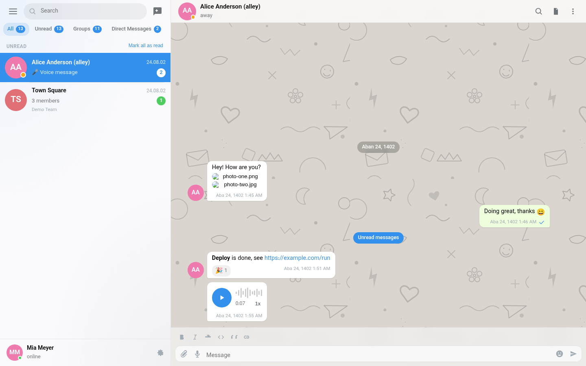
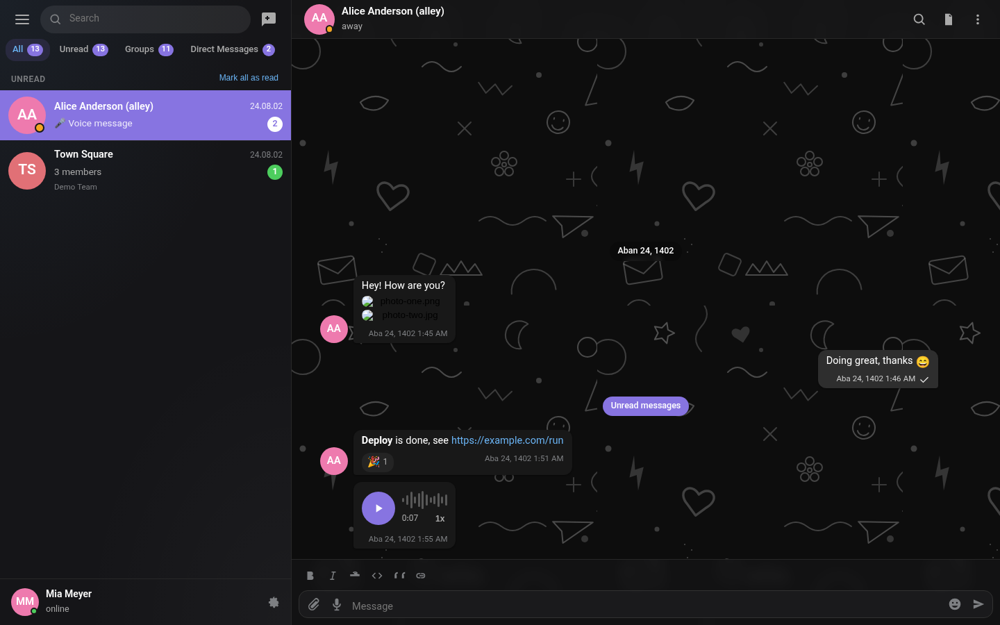

# Telegram Web UI — a Mattermost plugin

Gives the Mattermost web app a Telegram Web (K) style client: a chat list with **contacts**,
**groups** and **custom groups**, and a Telegram look for the **chat screen** — all built from the
data and state the Mattermost web app already has. Nothing is imported from outside Mattermost, a
small optional server component only tracks Telegram-style message view counts, and a single
button switches back to the stock UI.

**[Open the rendered preview →](docs/ui-preview.html)** — a static snapshot of the actual UI
(generated from the real components and stylesheet by `npm run preview`), also available in the dark
theme as [`docs/ui-preview-dark.html`](docs/ui-preview-dark.html).

<p align="center">
  
  
</p>

## Compatibility

| Item | Value |
| --- | --- |
| Target Mattermost | **v12.0+** (built and verified against the React 19 web app that ships with v12.0); also runs on v11.x hosts (React 18), which the classic JSX output stays compatible with |
| `min_server_version` | `12.0.0` |
| Server component | small Go binary (`server/`) — records who saw which post so the web app can show Telegram-style view counts; only linux-amd64/arm64 builds ship |
| Bundle | `webapp/dist/main.js` (a single ~190 KB minified file, CSS inlined) |
| React | never bundled — `react` / `react-dom` are webpack `externals` resolved from the host globals (`window.React`, `window.ReactDOM`), so the plugin always runs on the host's React instance (React 19 on Mattermost v12); the test harness runs on React 19 to match |

## Install

**From the packaged release**

1. Download the latest release from [Releases](./releases) in github
2. Open **System Console → Plugin Management → Plugin Management**.
3. *Upload Plugin* → choose `release/com.telegramweb.ui-1.0.0.tar.gz`.
4. **Enable** the plugin. Reload the web app.

**From source** (Node 24+ and Go 1.26+ — the minimum tested versions)

```bash
make release         # npm install + webpack build + go build (linux amd64/arm64) + package
# → release/com.telegramweb.ui-1.0.0.tar.gz   (plugin.json + assets/ + webapp/dist/main.js + server/dist/)
```

**Cutting a release** — push a version tag. GitHub Actions applies the tag as the version in
`plugin.json` and `webapp/package.json` (plus the lockfile), runs the checks, packages
`release/com.telegramweb.ui-<version>.tar.gz` and attaches it and its `checksums.txt` to the
GitHub release for that tag:

```bash
git tag v1.2.3
git push origin v1.2.3
```

Every push and pull request also runs the same checks (type check, smoke tests, bundle tests,
packaging) via `.github/workflows/ci.yml`. The version stamping alone is available locally as
`make version VERSION=1.2.3`.

## Using it

* **Turn it on / off** — the paper-plane icon in the channel header, **Main Menu → Telegram Web UI**,
  or the plugin's own *Settings → Switch back to Mattermost UI*. While it is off, Mattermost behaves
  exactly as before.
* **Chat list** — the folder row at the top is built from your Mattermost sidebar categories
  (`All`, `Unread`, one tab per category — *including custom categories* — and `Contacts`).
  Direct messages appear as Telegram contacts with avatar, status dot and online/away/do-not-disturb
  label; public and private channels and group messages appear as groups with a member count.
  The `Unread` folder stays personal: it lists direct messages (and group messages) with unread
  messages plus any channel that mentions you — its badge counts those DM messages and group
  mentions, so ordinary group traffic never fills it.
* **Search** — people and message results in one list, like Telegram's global search.
* **Chat screen** — Telegram message bubbles with tails, grouped messages, date separators, "Unread
  messages" divider, reactions (add/remove from the picker), replies and threads, attachments shown
  as image/album/file/audio/video cards, typing indicators, edit/delete aware rendering, emoji
  shortcodes and `**markdown**`, `@mentions` highlighting, in-chat search, unread counters, and a
  scroll-to-latest pill.
* **Per-chat actions** — mute/unmute, add to favorites (Mattermost favorite category), mark as read,
  copy channel link, channel/contact info panel with members and shared files, leave channel.
* **Composer** — attachment tray, emoji picker, reply bar, `Enter` sends, `Shift+Enter` adds a line,
  optimistic "sending…" bubble that is reconciled with the server response.
* **Create** — *New Message* (opens/creates a DM), *New Group* (group message), *New Channel*, plus
  add-members and channel-details modals, all dispatching through the Mattermost REST API.

## Where the data comes from

Everything is read from Mattermost's own Redux store and REST API — no external service, no copy of
the data:

| Telegram Web concept | Mattermost source |
| --- | --- |
| Contact (DM) | channel of type `D` + `entities.users.profiles` peer, `channels.myMembers` for unread counts |
| Group | channel of type `O` / `P` / `G`, `entities.channels.stats` / `membersInChannel` for the member count |
| Custom group / folder | `entities.channelCategories.byId` + `orderByTeam` (including user-created `custom` categories) |
| Chat row preview | last post from `entities.posts` or the plugin's own post cache |
| Message bubbles | posts, `post.metadata` (reactions, files, images, embeds) |
| Message formatting | host-provided `PostUtils.formatText` + `messageHtmlToComponent` (from `window`, with a built-in fallback renderer) |
| Typing indicator | `entities.typing` + the `typing` websocket event |
| Threads | `entities.posts.postsInThread` + `postsReplies` |
| Unread / mentions | `channels.myMembers.msg_count`, `mention_count`, `entities.posts.acknowledgements` |
| Send / react / mute / leave / view | REST API (`POST /posts`, `/reactions`, `.../notify_props`, `/view`, …) with session cookie + CSRF |

## Architecture

```
plugin.json                     plugin manifest (id, settings_schema, webapp.bundle_path)
assets/icon.svg                 plugin icon
Makefile                        build + package (webapp + Go server component)
release/                        installable tarball
webapp/
  webpack.config.js             entry, css loaders, host-global externals
  babel.config.js               preset-env / preset-react (classic) / preset-typescript
  src/index.tsx                 window.registerPlugin(): root component, header button, WS events
  src/styles.css                the whole Telegram Web theme (scoped under .tgw-root)
  src/mm/                       Mattermost glue: api, store bridge, selectors, post cache, settings,
                                emoji map, formatters  (no mattermost-redux dependency)
  src/ui/                       the UI: TelegramUI, Sidebar, ChatList, ChatView, MessageList,
                                Composer, ThreadPanel, InfoPanel, Modals, EmojiPicker, primitives
  test/                         harness.js + smoke.js + bundle.js + preview.js (see below)
docs/                           rendered UI snapshots (static HTML, no server needed)
```

The plugin deliberately keeps its own thin data layer (`src/mm/`) instead of importing
`mattermost-redux`: it reads the store the host hands to `initialize(registry, store)`, subscribes to
it directly and talks to the REST API with the session cookie + CSRF token, which keeps the bundle
small and tolerant of Mattermost internals moving between releases.

## Settings

Server side defaults live in `plugin.json → settings_schema` (`DefaultMode`, `DefaultTheme`,
`DefaultAccent`, `DefaultWallpaper`, `DefaultGlassyMode`, `DefaultCompactMode`,
`DefaultAnimations`, `DefaultJalali`) and are read from the client config, so an admin can enable
the Telegram UI for everyone by default — and choose whether dates render in the Jalali (Solar
Hijri) calendar. Per-user choices (theme, accent color, compact message list, animations, chat
previews, folder tabs, Jalali dates, URL sync) are stored as a Mattermost user preference under
`com.telegramweb.ui--settings`, so they follow the user across browsers.

## Development

```bash
cd webapp
npm install
npm run build          # production bundle → webapp/dist/main.js
npm run build:watch    # rebuild on change
npm run check-types    # tsc --noEmit
npm run preview        # regenerate docs/ui-preview.html from the real components
npm test               # (from the repo root: `make test`) type check + both test suites
```

### Tests

Both suites run the plugin without a Mattermost server, in jsdom, against a simulated store and REST
API (`webapp/test/harness.js` builds an `entities`-shaped Redux state and stubs `fetch`, recording
every call):

* `npm run test:smoke` (`test/smoke.js`) mounts `src/` directly and checks that contacts, channels
  and custom categories render, messages load over REST and are marked read, reactions render,
  switching chats works, sending a message posts to the API and shows optimistically, a websocket
  post reaches the open chat, search works, and settings load.
* `npm run test:bundle` (`test/bundle.js`) loads the **built** `dist/main.js` behind a stand-in for
  the Mattermost plugin host and checks the things only the artifact can prove: the bundle
  self-registers with `window.registerPlugin(<id from plugin.json>)`, `initialize()` works against a
  host-shaped registry, React comes from the host globals (no second React copy), the CSS is inlined
  in the bundle, websocket handlers reach the UI, `tgw:disable` hides it again and `uninitialize()`
  unregisters the handlers.

## Notes and limitations

* The plugin is a client-side overlay: it renders only for users who have it enabled, and the stock
  Mattermost UI stays one click away. The Go server component only records message view counts for
  this plugin's own UI; the stock Mattermost UI never reads or shows that data.
* User settings survive a reload by being stored as a Mattermost user preference rather than in
  plugin KV storage.
* Message rendering prefers the host's `formatText`/`messageHtmlToComponent`; if a future release
  stops exposing them, the built-in fallback renderer (markdown-lite, links, shortcodes, mentions)
  takes over instead of breaking the chat screen.
* File attachments are rendered from the server's public file URLs, so they need the same
  authentication/session the web app itself uses.

## Licensing

This plugins is distributed under [MIT license](./LICENSE).
